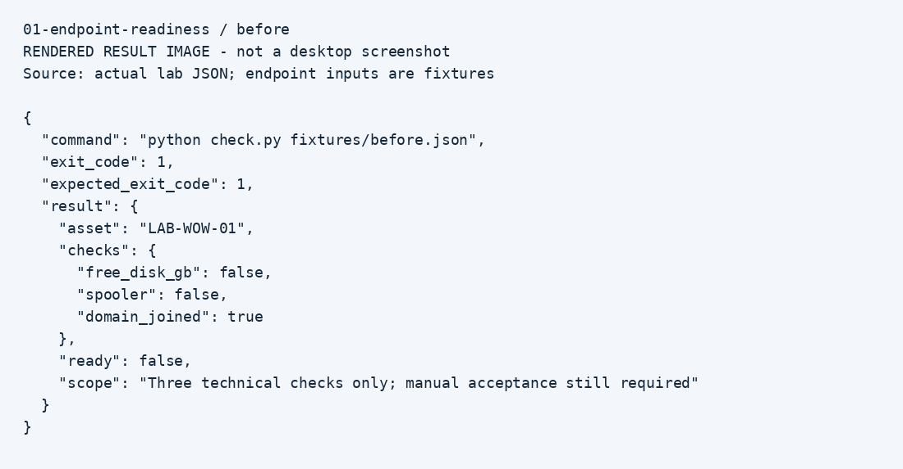
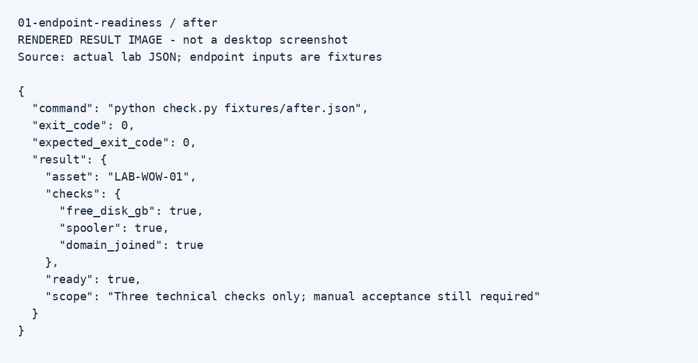

# Windows endpoint readiness

## Why this lab
This exercise relates to windows imaging, wow cart readiness, peripheral troubleshooting. The goal is to show a repeatable investigation with evidence and a clear stopping point.

## Setup
Python 3.10+; use a terminal inside this folder. Windows users replace `python3` with `py`. No third-party Python packages.

## Walkthrough
1. Open `fixtures/before.json`. The disk has 8 GB free and the spooler is stopped.
2. Run `python3 check.py fixtures/before.json` from this project folder.
3. Expect exit code 1, with disk and spooler checks false. This is an expected failed assessment.
4. Compare `fixtures/after.json`: free disk is 35 GB and spooler is Running.
5. Run `python3 check.py fixtures/after.json`. Expect exit code 0.
6. Read both JSON records under `evidence/`. The fixture change models remediation; the script did not clear disk or restart a real service.
7. On a personal Windows lab PC, open PowerShell in this folder and run `.\Collect-Readiness.ps1`. Then run `py check.py local-readiness.json`. Follow your device policy if script execution is restricted.
8. A personal PC without domain membership should fail the domain check. Do not join an employer domain for this exercise.
9. For a complete deployment acceptance test, manually check Device Manager, approved applications, a printer test page, scanner input into a blank text editor, and user sign-in. Record only what you actually tested.

## Observed result
Fixture LAB-WOW-01 fails the disk and spooler checks. Corrected fixture passes all three checks. This proves evaluator behavior, not physical printer functionality.

## Evidence

These are rendered result images, not desktop screenshots. Raw records are in `evidence/`. Run `python3 run_all.py` from the repository root to regenerate records.

## Limitations
No real Windows remediation, imaging, SCCM, Intune, AD change, or printer test was executed. Domain membership alone does not prove domain connectivity or trust health.

## Interview discussion
Explain the initial symptom, which check narrowed it down, what changed, how the result was verified, and what this lab cannot prove. Add your own observations after repeating the exercise.
