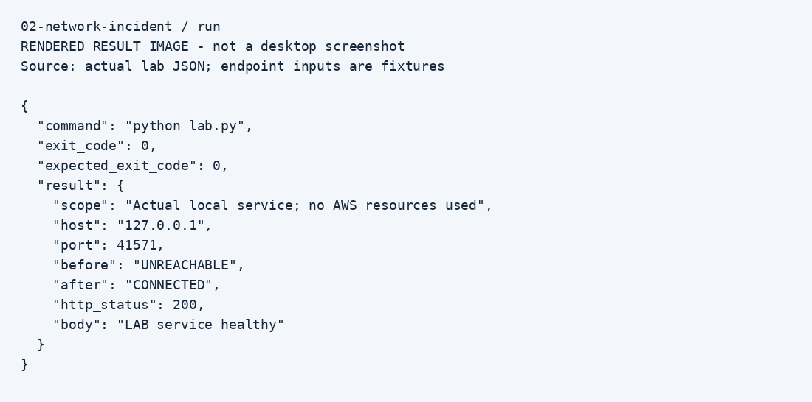

# Service connectivity incident

## Why this lab
This exercise relates to aws/windows connectivity triage and service restoration. The goal is to show a repeatable investigation with evidence and a clear stopping point.

## Setup
Python 3.10+; use a terminal inside this folder. Windows users replace `python3` with `py`. No third-party Python packages.

## Walkthrough
1. Run `python3 lab.py` inside this folder.
2. The lab reserves a loopback port without starting a listener. The first TCP connection fails.
3. The same process starts an HTTP listener on that port.
4. A second TCP probe succeeds. An HTTP GET returns 200 and the expected body.
5. The listener is shut down automatically. Read `evidence/run.json` after the root runner completes.
6. Explain the distinction: TCP connection success proves a listener was reachable; HTTP body validation gives an additional application check.
7. For an authorized cloud lab later, record hostname resolution, target port, listener state, route, security group, and host firewall evidence separately. A timeout alone does not identify which component blocked traffic.

## Observed result
A local service had no active listener. Starting that listener restored TCP and HTTP access. No firewall or network configuration was changed.

## Evidence

These are rendered result images, not desktop screenshots. Raw records are in `evidence/`. Run `python3 run_all.py` from the repository root to regenerate records.

## Limitations
Loopback bypasses VPC routing and security groups. This is not evidence of an AWS deployment, RDS database connection, DNS repair, or remote network diagnosis.

## Interview discussion
Explain the initial symptom, which check narrowed it down, what changed, how the result was verified, and what this lab cannot prove. Add your own observations after repeating the exercise.
