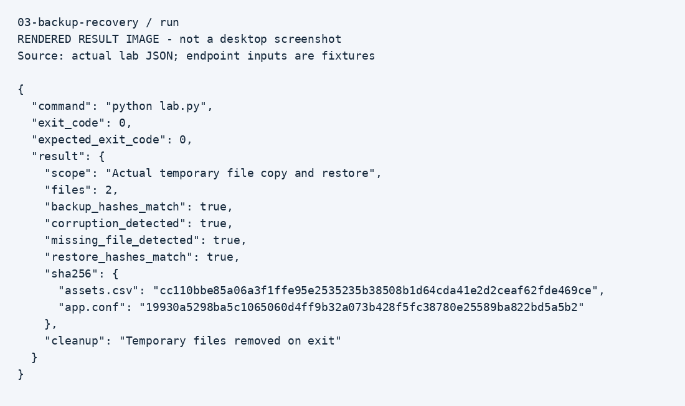

# Backup integrity and recovery

## Why this lab
This exercise relates to windows/linux server backup and restore validation. The goal is to show a repeatable investigation with evidence and a clear stopping point.

## Setup
Python 3.10+; use a terminal inside this folder. Windows users replace `python3` with `py`. No third-party Python packages.

## Walkthrough
1. Run `python3 lab.py` inside this folder.
2. The program creates two synthetic files in a unique temporary directory.
3. It calculates SHA-256 values, copies the files to a backup directory, and verifies the copy.
4. It deliberately corrupts the lab configuration and deletes the lab inventory file.
5. It detects both conditions and restores the backup into a new directory.
6. It compares every restored file hash against the original manifest.
7. Check that backup_hashes_match, corruption_detected, missing_file_detected, and restore_hashes_match are all true.
8. Temporary data is removed automatically. JSON evidence and screenshots remain in this repository when run through the root runner.

## Observed result
The original lab configuration was corrupted and a second file was missing. Restoring into a separate directory recovered both files with matching SHA-256 hashes.

## Evidence

These are rendered result images, not desktop screenshots. Raw records are in `evidence/`. Run `python3 run_all.py` from the repository root to regenerate records.

## Limitations
A same-disk copy is not production backup protection. This lab does not validate ACLs, application consistency, offsite storage, encryption, retention, or disaster recovery RPO/RTO.

## Interview discussion
Explain the initial symptom, which check narrowed it down, what changed, how the result was verified, and what this lab cannot prove. Add your own observations after repeating the exercise.
