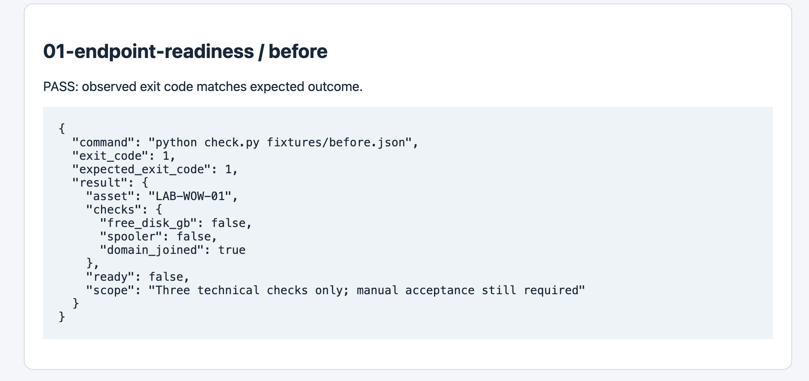
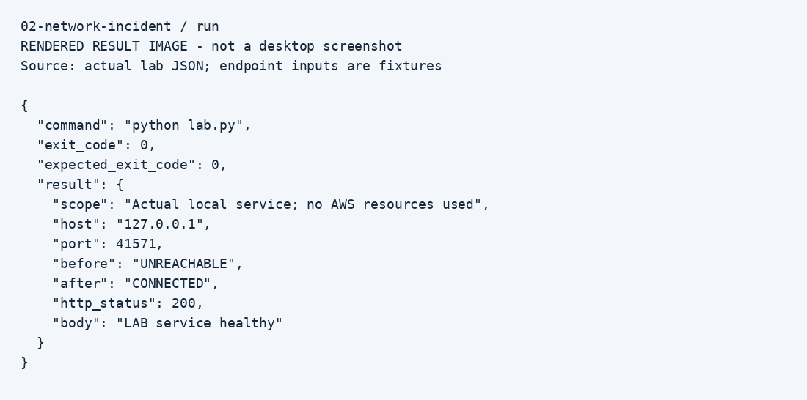
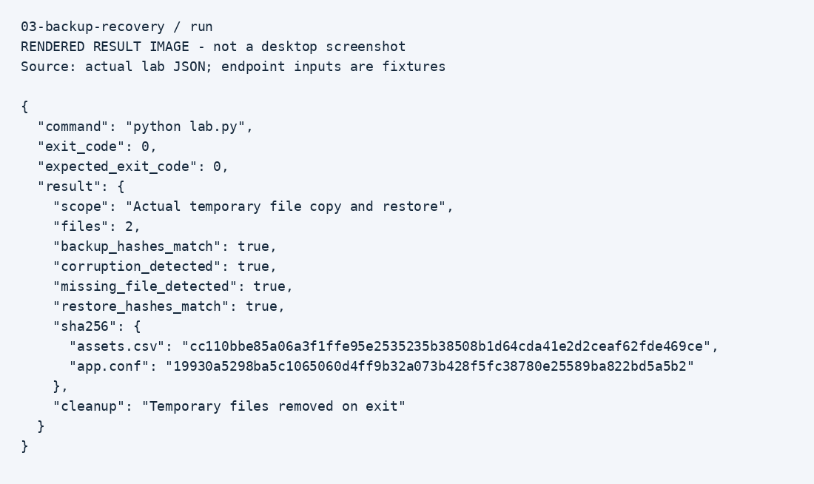

# IT Operations Labs — Manohar Eddagiri

Three small, reproducible labs covering the troubleshooting work behind endpoint support, cloud connectivity, and server recovery.

These are portfolio labs inspired by the responsibilities on my résumé. They are not exports from employer systems. The included evidence was generated during preparation of this bundle; my own repeat-run notes belong in [MY-LAB-NOTES.md](MY-LAB-NOTES.md).

| Project | Work it connects to | Demonstration |
|---|---|---|
| [Endpoint readiness](01-endpoint-readiness/README.md) | Windows deployment and WOW cart support | Reject a failing readiness fixture, then validate corrected inputs |
| [Network incident](02-network-incident/README.md) | Cloud infrastructure connectivity troubleshooting | Reproduce an unavailable local TCP service and verify recovery |
| [Backup recovery](03-backup-recovery/README.md) | Server backup and restore validation | Detect damage and restore files with SHA-256 verification |

## Run the labs
Install Python 3.10 or newer. No third-party Python packages, cloud account, payment, or administrator privileges are needed for the demo runs.

Open a terminal in this folder:
```bash
python3 run_all.py
python3 -m unittest discover -s tests -v
```
On Windows, replace `python3` with `py`. Open `evidence.html` in a browser afterward.

## Evidence
Each project includes raw JSON and rendered images of the actual JSON results. They show actual program output, not Windows, ServiceNow, or AWS console screenshots.
The Windows collector is supplied for a personal lab and was not executed in the preparation environment.





Read [START-HERE.md](START-HERE.md) for the complete sequence and [UPLOAD-TO-GITHUB.md](UPLOAD-TO-GITHUB.md) for publishing instructions.

I ran these portfolio labs on my MacBook. All five automated tests passed.
